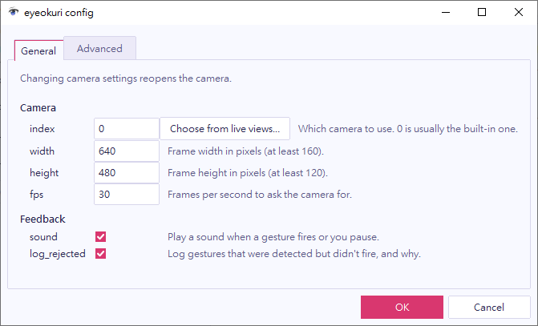

Open **Settings > Config…** in the main window. The **General** tab has the camera and feedback settings. The **Advanced** tab has the eye and head baseline settings.

## Choose a camera

Changing a camera setting reopens the camera.

| Setting | Meaning |
| --- | --- |
| **index** | Which camera to use. 0 is usually the built-in one. |
| **width**, **height** | The frame size in pixels. |
| **fps** | The frames per second to ask the camera for. |

If you have several cameras, select **Choose from live views…** next to **index**. eyeokuri lists every camera it finds with its live view. Select the one to use.

## Control sounds and the log

- **sound** plays a sound when a gesture fires or when you pause or resume.
- **log_rejected** logs gestures that were detected but didn't fire, with the reason.

## Tune the baselines

eyeokuri learns your usual open-eye level and your usual head position, and keeps adapting as your posture changes. The **Advanced** tab sets how it learns:

- **baseline_window_s** is how many seconds of history it uses. Try 5 for the eyes if lighting or distance changes quickly. Raise it for the head if looking away for a while shifts your zero.
- **warmup_s** is how many seconds it learns before gestures can fire. It must be below the window.
- **require_both_eyes** requires both eyes to close, so a wink doesn't count.

## Change the language

The window follows your Windows display language when eyeokuri has a translation for it, and uses English otherwise. To pick a language yourself, set `language` in the `[app]` section of `config.toml` to `"en"`, `"ja"` or `"zh-TW"`. The default, `"auto"`, follows Windows. The change applies the next time you start the window.

## Save or cancel

The config window works like the [gesture window](../edit-a-gesture/#save-or-cancel). eyeokuri uses your changes at once, **OK** saves them, and **Cancel** goes back to the settings you had when you opened the window.
