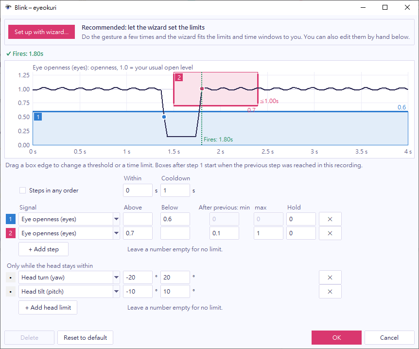

The gear button (⚙) on a gesture's row opens its window. You change the gesture's settings here and see the result on your own movement at once.

## Read the plot

A gesture is a list of steps. Each step is a box on a plot of one signal over time, and a step counts the moment the signal enters its box. The signals are:

- **eyes:** how open your eyes are. 1.0 is your usual open level.
- **pitch:** head tilt in degrees. Positive is down.
- **yaw:** head turn in degrees. Positive is your left.

The blink in the screenshot has two steps. Box 1 is "eyes below 0.6", and box 2 is "eyes above 0.7, between 0.1 s and 1 s after step 1". The dark line is your signal over the last 4 seconds.

## Test your settings

1. Open the gesture window and do the gesture.
2. Read the line above the plot. It says `✓ Fires: 1.83s`, or why the gesture doesn't fire, for example `✕ Step 2 came 0.07s after step 1 (too short, min 0.10s)`.
3. Change a setting and read the line again. It updates as you change the settings.

The plot keeps only the eye and head numbers, in memory. It never keeps images.

## Change a limit

You can change a limit in two ways:

- Drag a box's top or bottom edge to change its threshold. Drag its left or right edge to change the time allowed after the previous step.
- Type the numbers in the steps table below the plot.

Each step has its own settings, so changing one step doesn't affect the others.

| Column | Meaning |
| --- | --- |
| **Signal** | The signal the step watches. A step can also watch another gesture and counts when that gesture fires. |
| **Above**, **Below** | The box. Leave one empty for a box that is open on that side. |
| **After previous: min**, **max** | The time allowed since the previous step. 0 means no limit. |
| **Hold** | How long the signal must stay in the box before the step counts. |

Above the plot:

- **Within** is the time allowed from the first step to the last. 0 means no limit.
- **Cooldown** is the time after the gesture fires during which it can't fire again.
- **Steps in any order** lets the steps happen in either order. The head shake uses it, so you can start on either side.

## Keep the gesture from firing while you look away

Moving your head often makes you blink, and a turned or tilted head also changes how open your eyes look. The **Only while the head stays within** rows limit the head angle for the whole gesture. While your head is outside a limit, the gesture can't start, and one in progress is canceled. The log says why, for example `blink: canceled (head yaw +25° outside its limit)`.

By default, a blink counts only when your head is within 20° of your usual pose sideways and 15° up or down. Remove the rows to count blinks at any head angle.

## Choose what the gesture sends

**Output** is what the gesture sends. You can type it, choose it from the list, or select **Press a key…** and press the key or combination.

- A key, such as `enter`, `space`, `up`, `f5` or `a`.
- A key with modifiers (`ctrl`, `shift`, `alt`, `win`), joined with `+`, such as `ctrl+s`.
- A mouse input: `left_click`, `right_click` or `wheel_down`.
- `app:toggle_pause`, which pauses or resumes eyeokuri.
- `(none)`, which sends nothing. Use it for a gesture that other gestures use as a step.

## Save or cancel

eyeokuri uses your changes as soon as you make them. They aren't saved until you finish:

- **OK** saves the settings to the config file and closes the window.
- **Cancel** goes back to the settings you had when you opened the window and closes it. Closing the window another way works like **Cancel**, and asks first if you changed something.
- **Reset to default** puts a built-in gesture's settings back. It keeps the gesture on or off as it is.
- **Delete** removes a gesture you added. If another gesture uses it as a step, remove it from there first. You can't delete a built-in gesture. Turn it off instead.

Saving rewrites the config file with only the values that differ from the defaults, so comments in the file are not kept.

## Combine gestures

**New gesture…** in the main window adds your own gesture. Set a step's **Signal** to `gesture: nod_down`, for example, to build a gesture that needs another gesture first, such as a blink followed by a nod within 1.5 s.

When one movement matches several gestures, each gesture fires. A blink followed by a nod also fires the blink, so it sends the blink's key too.
