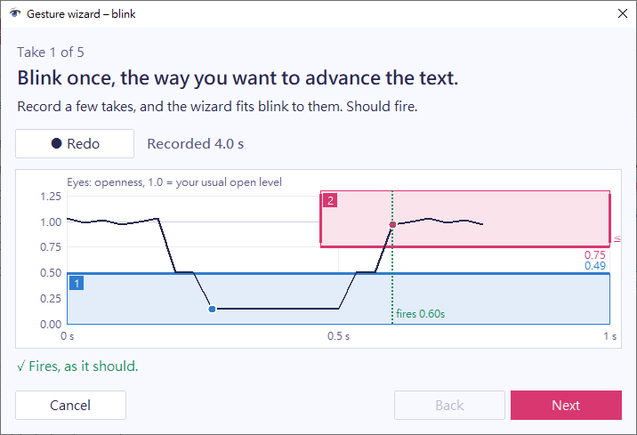

The wizard sets up a gesture from your own movement, so you don't have to work out the numbers. Open a gesture's window and select **Set up with wizard…**.

## Record the takes

The wizard asks for the gesture itself 3 times, done the way you want it to count, and then for each near miss once. For a blink, the near misses are a quick natural blink and a long eye closure.

Each take has its own page that says what to do:

1. Select **Record**, or press `Space`.
2. Do what the page says.
3. Select **Stop**, or press `Space` again.

The page shows whether the take fires with the settings fitted so far. Select **Redo** to record it again, or **Next** to go on. You can skip a near miss with **Skip**.

For a too-quick or too-slow take, you also choose whether it should fire. For example, choose **Yes** on the quick blink if you want everyday blinks to advance the text.

Gestures are off while the wizard is open, so nothing is sent to other windows.

## Review the fit

The wizard fits the gesture to all your takes:

- It moves each step's edge to 60% of the way to your weakest take. A movement counts once it holds for two frames, so one stray frame can't set the edge.
- If a take that shouldn't fire moves further than that, the edge moves above it when there is room. When no setting can tell the take apart from the others, the review page says so.
- It fits the time limits that the gesture already has between your takes and the near misses. Limits that are off stay off.

The review page lists whether each take fires with the new settings and what changed. Select a take to see it on the plot. Select **Redo take** to record one again.

## Use the result

Select **Use these settings**. The wizard puts the result in the gesture window, and the gesture uses it right away. Then select **OK** in the gesture window to save it, or [fine-tune it](../edit-a-gesture/) first.

## Limits of the wizard

The wizard starts from your edits in the gesture window. **Set up with wizard…** is available only when those edits are valid and every step watches a signal. A gesture whose steps are other gestures can't use the wizard. Set up the gestures it's made of instead.
