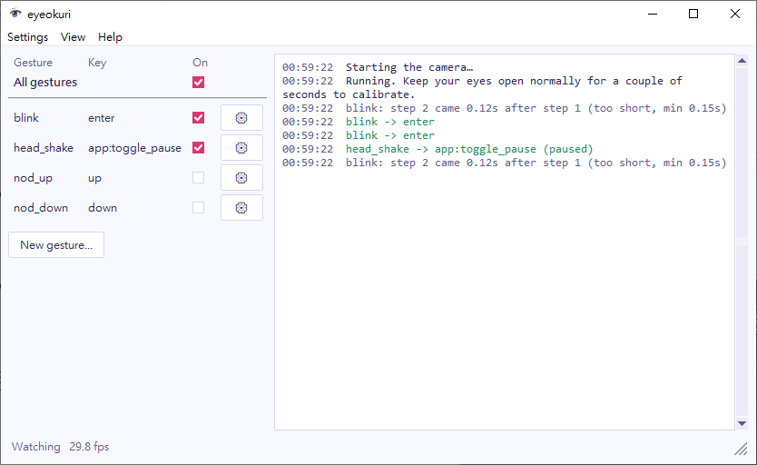

The main window lists your gestures on the left and shows the log on the right. Start it with `eyeokuri-gui`, or by opening the Windows build.

## Turn gestures on and off

Each gesture row shows the gesture's name and the key it sends. It has two controls:

- The checkbox in the **On** column turns the gesture on or off. eyeokuri saves the change to the config file right away.
- The gear button (⚙) opens the gesture's window. See [Edit a gesture](/guide/edit-a-gesture/).

**New gesture…** asks for a name, then opens a gesture window for the new gesture.

## Pause eyeokuri

The **All gestures** checkbox at the top of the list pauses and resumes eyeokuri. The `p` key and a head shake do the same.

While paused, gestures still fire but only appear in the log, for example `blink: ... -> enter (paused, not sent)`. Pause when you want to try gestures without sending input to your game. eyeokuri saves the pause state, so the next start begins paused if you left it paused.

## Read the log

The log shows:

- Gestures that fired, in green, for example `blink -> enter`.
- Gestures that were detected but didn't fire, in gray, with the reason, for example `blink: step 2 came 0.12s after step 1 (too short, min 0.15s)`.
- Pauses and resumes.

The reasons tell you which setting to change. To stop logging gestures that don't fire, clear **log_rejected** in the [config window](/guide/config-window/).

The status bar at the bottom shows what eyeokuri sees: `Calibrating…`, `Watching`, `Eyes closed`, `No face` or `Paused`, and the frame rate. While you edit a gesture, it shows `Gestures off while editing`.

## Open the other windows

| Menu | Entry | Opens |
| --- | --- | --- |
| Settings | **Config…** | The [config window](/guide/config-window/) for the camera, sounds and logging. |
| View | **Camera view…** | A live view of your camera with your eye outlines and signal values. |
| Help | **About eyeokuri…** | The license and third-party notices. |

The camera view appears next to the main window. eyeokuri draws it only while the window is open, so close it when you don't need it to save CPU.

While a gesture, config or wizard window is open, gestures are off and the main window's controls are disabled. Only one of these windows can be open at a time.

## If the camera stops

If the camera stops sending frames, for example when it disconnects for a moment, eyeokuri reopens it every second until frames come back. Gestures aren't detected during the gap.
