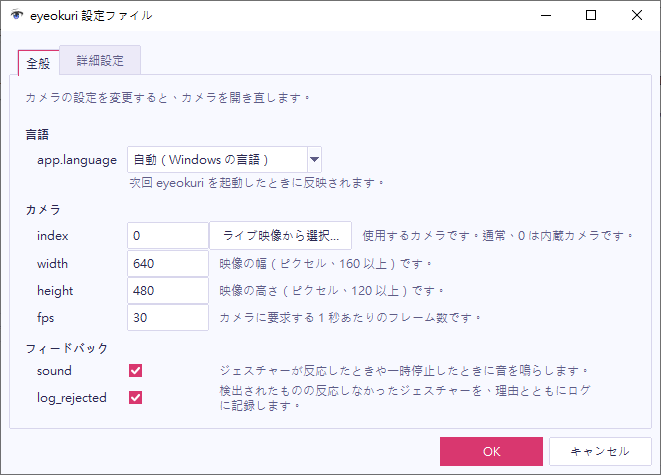

メインウィンドウで **設定 > 設定ファイル…** を開きます。**全般**タブにはカメラとフィードバックの設定があり、**詳細設定**タブには目と頭の基準値の設定があります。

## カメラを選ぶ

カメラの設定を変更すると、カメラが開き直されます。

| 設定 | 意味 |
| --- | --- |
| **index** | 使用するカメラです。通常、0 は内蔵カメラです。 |
| **width**、**height** | 映像の幅と高さです（ピクセル）。 |
| **fps** | カメラに要求する 1 秒あたりのフレーム数です。 |

カメラが複数ある場合は、**index** の隣にある **ライブ映像から選択…** を選んでください。アイ送りが見つけたすべてのカメラが、ライブ映像とともに一覧表示されます。使用するカメラを選んでください。

## サウンドとログを設定する

- **sound**：ジェスチャーが反応したとき、または一時停止や再開をしたときに、音を鳴らします。
- **log_rejected**：検出されたものの反応しなかったジェスチャーを、理由とともにログに記録します。

## 基準値を調整する

アイ送りは、普段の目の開き具合と頭の位置を学習し、姿勢が変わっても合わせ続けます。**詳細設定**タブでは、その学習のしかたを設定します。

- **baseline_window_s**：学習に使う履歴の秒数です。明るさや距離がよく変わる場合は、目の設定を 5 にしてみてください。しばらく目をそらすと基準がずれる場合は、頭の設定を大きくしてください。
- **warmup_s**：ジェスチャーが反応し始めるまでに学習する秒数です。履歴の秒数より小さくする必要があります。
- **require_both_eyes**：両目を閉じることを必須にします。そのため、ウィンクは数えません。

## 言語を変更する

アイ送りに翻訳がある場合、ウィンドウは Windows の表示言語に合わせます。翻訳がない場合は英語になります。言語を自分で選ぶには、`config.toml` の `[app]` セクションにある `language` を `"en"`、`"ja"`、`"zh-TW"` のいずれかに設定してください。初期値の `"auto"` は Windows に合わせます。変更は、次回ウィンドウを起動したときに反映されます。

## 保存またはキャンセルする

設定ファイルのウィンドウは、[ジェスチャーのウィンドウ](/ja/guide/edit-a-gesture/#保存またはキャンセルする)と同じように動作します。変更はすぐにアイ送りに反映され、**OK** で保存され、**キャンセル**でウィンドウを開いたときの設定に戻ります。
