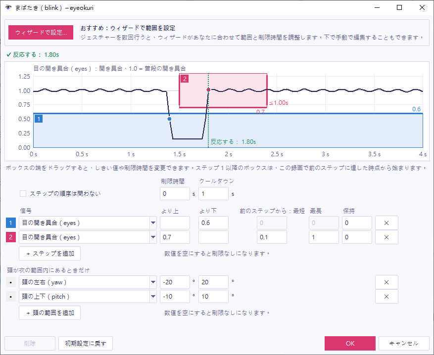

ジェスチャーの行にある歯車ボタン（⚙）を押すと、そのジェスチャーのウィンドウが開きます。ここでジェスチャーの設定を変更し、自分の動きでその結果をすぐに確認できます。

## グラフを読む

ジェスチャーは、ステップの並びです。各ステップは、1 つの信号を時間に沿って表したグラフ上のボックスで、信号がボックスに入った瞬間にステップが成立します。信号は次のとおりです。

- **目**（`eyes`）：目の開き具合です。1.0 が普段の開き具合です。
- **ウィンク**（`wink`）：右目の開き具合から左目の開き具合を引いた値です。それぞれ普段の開き具合に対する比率です。両目を開けているときや両目を閉じているときは 0 付近のままです。左目だけを閉じると +1 に近づき、右目だけを閉じると −1 に近づきます。
- **頭の上下**（`pitch`）：頭の上下の傾きです（単位は度）。正の値は下向きです。
- **頭の左右**（`yaw`）：頭の左右の向きです（単位は度）。正の値は、自分から見て左向きです。
- **頭の横の傾き**（`roll`）：頭を肩のほうへ傾けた角度です（単位は度）。正の値は、左肩のほうへの傾きです。

スクリーンショットのまばたきには、2 つのステップがあります。ボックス 1 は「eyes が 0.6 より下」で、ボックス 2 は「eyes が 0.7 より上、ステップ 1 から 0.1 秒～1 秒後」です。濃い線は、直近 4 秒間の信号です。

## 設定を試す

1. ジェスチャーのウィンドウを開き、ジェスチャーを行います。
2. グラフの上の行を読みます。`✓ 反応する： 1.83s` と表示されるか、反応しない理由が表示されます。たとえば `✕ Step 2 came 0.07s after step 1 (too short, min 0.10s)` です。
3. 設定を変更して、もう一度その行を読みます。設定を変更すると、表示も更新されます。

グラフに残るのは、目と頭の数値だけで、メモリ上にのみ保持されます。映像が残ることはありません。

## 範囲を変更する

範囲を変更する方法は 2 つあります。

- ボックスの上端または下端をドラッグして、しきい値を変更します。左端または右端をドラッグして、前のステップから許される時間を変更します。
- グラフの下にあるステップの表に、数値を入力します。

各ステップには専用の設定があるため、あるステップを変更しても、ほかのステップには影響しません。

| 列 | 意味 |
| --- | --- |
| **信号** | ステップが見る信号です。ステップは、別のジェスチャーを見ることもでき、そのジェスチャーが反応した時点で成立します。 |
| **より上**、**より下** | ボックスの範囲です。片方を空にすると、その側が開いたボックスになります。 |
| **前のステップから：最短**、**最長** | 前のステップから許される時間です。0 は制限なしです。 |
| **保持** | ステップが成立するために、信号がボックスの中にとどまる必要がある時間です。 |

ステップの表の上には、次の項目があります。

- **制限時間**：最初のステップから最後のステップまでに許される時間です。0 は制限なしです。
- **クールダウン**：ジェスチャーが反応してから、もう一度反応できるようになるまでの時間です。
- **ステップの順序は問わない**：ステップをどちらの順序でも行えるようにします。首を振る動作はこの設定を使うため、どちら側からでも始められます。

## 目をそらしている間は反応させない

頭を動かすとまばたきしやすくなり、頭が横を向いたり傾いたりすると、目の開き具合の見え方も変わります。**頭が次の範囲内にあるときだけ**の行は、ジェスチャー全体について頭の角度を制限します。頭が範囲の外にある間は、ジェスチャーを開始できず、進行中のジェスチャーはキャンセルされます。理由はログに表示されます。たとえば `blink: canceled (head yaw +25° outside its limit)` です。

初期設定では、頭が普段の姿勢から左右に 20° 以内、上下に 10° 以内にあるときだけ、まばたきが数えられます。どの頭の角度でもまばたきを数えたい場合は、これらの行を削除してください。

## 保存またはキャンセルする

アイ送りは、変更した内容をすぐに反映します。ただし、操作を終えるまでは保存されません。

- **OK**：設定を設定ファイルに保存し、ウィンドウを閉じます。
- **キャンセル**：ウィンドウを開いたときの設定に戻し、ウィンドウを閉じます。ほかの方法でウィンドウを閉じた場合も **キャンセル** と同じ動作になり、変更があるときは先に確認が表示されます。
- **初期設定に戻す**：組み込みのジェスチャーの設定を元に戻します。ジェスチャーのオンとオフは、そのままです。ソフトのタブからウィンドウを開いた場合、このボタンは **基本の設定ファイルに戻す** になり、基本の設定ファイルの設定に戻します。
- **削除**：自分で追加したジェスチャーを削除します。ほかのジェスチャーがステップとして使っている場合は、先にそちらから外してください。組み込みのジェスチャーは削除できません。代わりにオフにしてください。ソフトのタブでは、そのタブで追加したジェスチャーだけを削除できます。

保存すると、設定ファイルは、初期値と異なる値だけで書き換えられます。そのため、ファイル内のコメントは残りません。

## ジェスチャーを組み合わせる

メインウィンドウの **新しいジェスチャー…** で、自分のジェスチャーを追加できます。ステップの **信号** を、たとえば **ジェスチャー：下にうなずく（nod_down）** に設定すると、先に別のジェスチャーが必要なジェスチャーを作れます。たとえば、まばたきのあとに 1.5 秒以内にうなずく、というジェスチャーです。

1 つの動きが複数のジェスチャーに一致した場合は、それぞれのジェスチャーが反応します。まばたきのあとにうなずくジェスチャーは、まばたきのジェスチャーも反応させるため、まばたきのキーも送られます。
