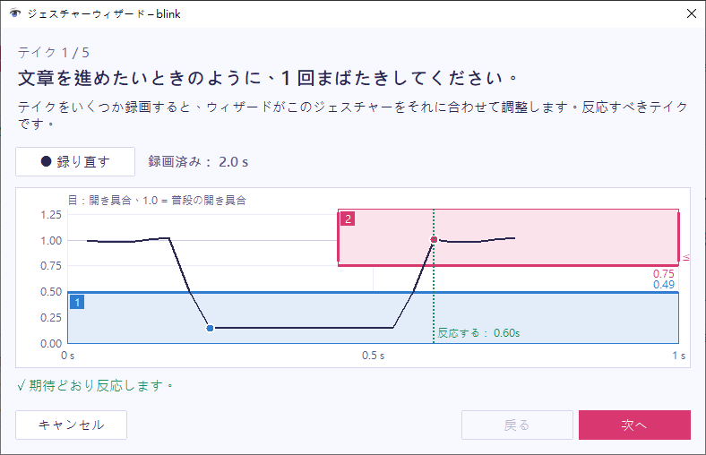

ウィザードは、あなた自身の動きからジェスチャーを設定するため、数値を自分で考える必要がありません。ジェスチャーのウィンドウを開き、**ウィザードで設定…** を選んでください。

## テイクを録画する

ウィザードは、まずジェスチャー本体を、実際に反応させたいやり方で 3 回求めます。続いて、早すぎ・遅すぎのテイクをそれぞれ 1 回ずつ求めます。まばたきの場合、早すぎ・遅すぎのテイクは、無意識にする短いまばたきと、長く目を閉じる動作です。

各テイクには専用のページがあり、行うことが表示されます。

1. **録画** を選ぶか、`Space` を押します。
2. ページに表示されたことを行います。
3. **停止** を選ぶか、もう一度 `Space` を押します。

ページには、ここまでに調整した設定でそのテイクが反応するかどうかが表示されます。もう一度録画するには **録り直す** を、先へ進むには **次へ** を選んでください。早すぎ・遅すぎのテイクは、**スキップ** で飛ばせます。

早すぎ・遅すぎのテイクでは、そのテイクを反応させるべきかどうかも選びます。たとえば、日常のまばたきで文章を進めたい場合は、短いまばたきのテイクで **はい** を選んでください。

ウィザードを開いている間はジェスチャーがオフになるため、ほかのウィンドウには何も送られません。

## 調整結果を確認する

ウィザードは、すべてのテイクに合わせてジェスチャーを調整します。

- 各ステップの端を、いちばん弱いテイクまでの距離の 60% の位置に動かします。動きは 2 フレーム続いた時点で数えられるため、1 フレームだけの外れ値で端が決まることはありません。
- 反応すべきでないテイクが、それより大きく動いている場合は、余裕があれば端をそのテイクより外側に動かします。ほかのテイクとそのテイクを見分けられる設定がない場合は、確認のページにそのことが表示されます。
- ジェスチャーにすでにある時間の制限は、反応すべきテイクと早すぎ・遅すぎのテイクの間に収まるように調整されます。オフになっている制限は、オフのままです。

確認のページには、新しい設定で各テイクが反応するかどうかと、変更された内容が表示されます。テイクを選ぶと、グラフで確認できます。テイクを録り直すには、**テイクを録り直す** を選んでください。

## 結果を使う

**この設定を使う** を選びます。ウィザードが結果をジェスチャーのウィンドウに反映し、ジェスチャーはすぐにその設定を使います。そのあと、ジェスチャーのウィンドウで **OK** を選んで保存するか、先に[微調整](../edit-a-gesture/)してください。

## ウィザードの制限

ウィザードは、ジェスチャーのウィンドウでの編集内容から始まります。**ウィザードで設定…** は、その編集内容が有効で、すべてのステップが信号を見ている場合にだけ使えます。ステップがほかのジェスチャーであるジェスチャーには、ウィザードを使えません。その場合は、構成要素のジェスチャーを設定してください。
