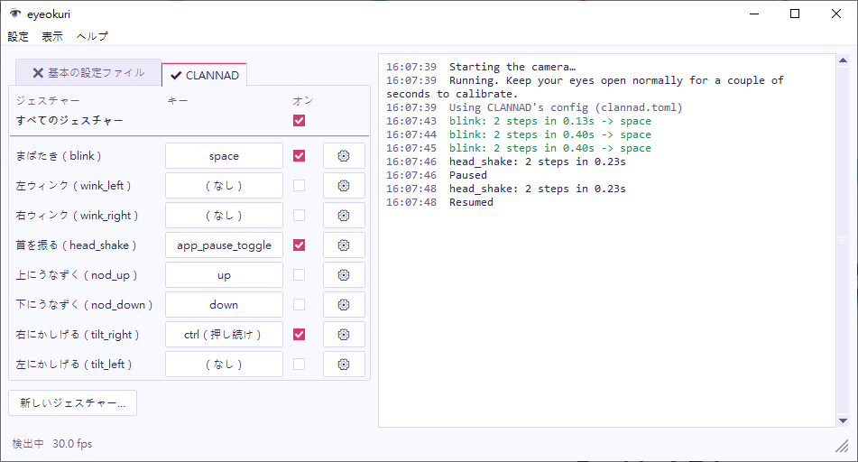

メインウィンドウでは、左側にジェスチャーの一覧、右側にログが表示されます。インストール後はスタートメニューから起動してください。ソースから実行する場合は `eyeokuri-gui` で起動します。

## ジェスチャーをオンまたはオフにする

各ジェスチャーの行には、ジェスチャーの名前が表示されます。操作は 3 つあります。

- **キー** 列のボタンには、ジェスチャーが送るキーが表示されます。選ぶとキーのウィンドウが開きます。[ジェスチャーが送る内容を選ぶ](#ジェスチャーが送る内容を選ぶ)を参照してください。
- **オン**列のチェックボックスで、ジェスチャーのオンとオフを切り替えます。変更はすぐに設定ファイルに保存されます。
- 歯車ボタン（⚙）で、そのジェスチャーのウィンドウを開きます。[ジェスチャーを編集する](../edit-a-gesture/)を参照してください。

**新しいジェスチャー…** を選ぶと、名前の入力を求められ、新しいジェスチャーのウィンドウが開きます。

## ジェスチャーが送る内容を選ぶ

ジェスチャーの行の **キー** 列にあるボタンには、ジェスチャーが送る内容が表示されます。押し続けるキーには `（押し続け）` が付きます。ボタンを選ぶと、キーのウィンドウが開きます。**キー** に直接入力するか、一覧から選ぶか、**キーを押してください…** を選んでキーまたはキーの組み合わせを押してください。**OK** で変更を保存し、**キャンセル** で元のキーに戻ります。

- キー。たとえば `enter`、`space`、`up`、`f5`、`a` です。
- 修飾キー（`ctrl`、`shift`、`alt`、`win`）付きのキー。`+` でつなぎます。たとえば `ctrl+s` です。
- マウス入力：`mouse_left_click`、`mouse_right_click`、`mouse_wheel_down` のいずれかです。
- `app_pause_toggle`：アイ送りの一時停止と再開を切り替えます。
- **（なし）**：何も送りません。ほかのジェスチャーがステップとして使うジェスチャーに使ってください。

## キーを押し続ける

ゲームによっては、`ctrl` を押している間テキストをスキップします。キーのウィンドウの **送り方** の一覧で、ジェスチャーが出力をどう送るかを選びます。

- **1 回押す（press）**：ジェスチャーが反応するたびに、アイ送りは出力を押して離します。
- **続いている間押し続ける（while）**：ジェスチャーが反応すると出力を押し、ジェスチャーが終わると離します。ログには `look: ... -> ctrl held`、続いて `-> ctrl released` と表示されます。ジェスチャーが終わるのは、ジェスチャーを完成させたステップのボックスから信号が出たときです。そのステップが別のジェスチャーの場合は、そのジェスチャーが終わったときです。頭がジェスチャーの頭の範囲から出たときも終わります。

たとえば、左目を閉じている間テキストをスキップするには、[ジェスチャーのウィンドウ](../edit-a-gesture/)でステップを 1 つにして、**ウィンク**、**より上** 0.25、**保持** 0.3 秒にします。キーのウィンドウで **キー** を `ctrl`、**送り方** を **続いている間押し続ける** にします。左目を 0.3 秒閉じ続けると `ctrl` が押され、目を開けると離れます。組み込みの右にかしげる（`tilt_right`）は、頭を右肩のほうへ傾けている間、この方法で `ctrl` を押し続けます。

一時停止したとき、顔がカメラから外れたとき、設定を編集するウィンドウを開いたとき、アイ送りを終了したときにも離します。

押し続けられるのは、キー、キーの組み合わせ、`mouse_left_click`、`mouse_right_click` です。押し続けているキーは、ゲームだけでなくすべてのアプリに効きます。押している間に別のウィンドウに切り替えると、そこで入力する内容にも `ctrl` が付きます。複数のジェスチャーで同じキーを使えます。2 つのジェスチャーが `ctrl` を押し続けている場合、両方が離すまで `ctrl` は押されたままです。キーを押し続けている間にタスク マネージャーでアイ送りを終了した場合は、そのキーを 1 回押すと離れます。

## ソフトごとに別のキーを使う

ゲームなどのソフトごとに、専用の設定ファイルを使えます。ジェスチャーの一覧の上に、タブが 2 つあります。

- **基本の設定ファイル** には、すべてのソフトで使う設定が入っています。
- 2 つ目のタブは、アイ送り以外で最後に使ったソフトのものです。そのソフトのウィンドウのタイトルが表示されます。

✔ は、アイ送りがいま使っている設定のタブを示します。ソフト別の設定ファイルを使っている間、**基本の設定ファイル** には ✖ が付きます。

ゲームに専用のキーを設定するには：

1. ゲームに切り替えてから、アイ送りに戻ります。2 つ目のタブには **新規作成：<ウィンドウのタイトル>** と表示され、アイ送りはまだ基本の設定ファイルを使っています。
2. そのタブを選び、キー、チェックボックス、ジェスチャーのどれかを変更します。アイ送りがそのゲーム用の設定ファイルを保存し、タブは **✔ <ウィンドウのタイトル>** になります。

それ以降、そのゲームが前面にある間はその設定ファイルを、ほかのソフトが前面にある間は基本の設定ファイルを使います。アイ送り、タスクバー、Alt+Tab に切り替えてもゲームのタブは残るので、ゲームの設定を変更できます。アイ送りはソフトを実行ファイル名（たとえば `CLANNAD.exe`）で見分けるため、ウィンドウのタイトルが変わっても問題ありません。同じ実行ファイル名で動くゲームは、1 つの設定ファイルを共有します。

ソフト別の設定ファイルには、基本の設定ファイルから変更した部分だけが保存されます。そのため、**基本の設定ファイル** での変更は、同じ設定を変更していないすべてのソフトに反映されます。ソフトのタブでは、ジェスチャーのウィンドウの **基本の設定ファイルに戻す** でジェスチャーを基本の設定ファイルの設定に戻せます。**削除** はそのタブで追加したジェスチャーにだけ使えます。一時停止と、設定ファイルのウィンドウの設定は、すべてのソフトに適用されます。

## アイ送りを一時停止する

一覧の上にある **すべてのジェスチャー** のチェックボックスで、アイ送りの一時停止と再開を切り替えます。`p` キーと首を振る動作でも同じ操作ができます。

一時停止中でもジェスチャーは反応しますが、ログに表示されるだけです。たとえば `blink: ... -> enter (paused, not sent)` のように表示されます。ゲームに入力を送らずにジェスチャーを試したいときは、一時停止してください。一時停止の状態は保存されるため、一時停止のまま終了すると、次回も一時停止の状態で起動します。

## ログを読む

ログには次の内容が表示されます。

- 反応したジェスチャー（緑色）。たとえば `blink -> enter` です。
- 検出されたものの反応しなかったジェスチャー（灰色）と、その理由。たとえば `blink: step 2 came 0.07s after step 1 (too short, min 0.10s)` です。
- 一時停止と再開。

理由を読むと、どの設定を変えればよいかが分かります。反応しなかったジェスチャーをログに記録したくない場合は、[設定ファイルのウィンドウ](../config-window/)で **log_rejected** のチェックを外してください。

下部のステータスバーには、アイ送りが見ている状態が表示されます。**調整中…**、**検出中**、**目を閉じています**、**顔が見つかりません**、**一時停止中** のいずれかと、フレームレートです。ジェスチャーを編集している間は、**編集中はジェスチャーをオフにしています** と表示されます。

## ほかのウィンドウを開く

| メニュー | 項目 | 開くウィンドウ |
| --- | --- | --- |
| 設定 | **設定ファイル…** | カメラ、サウンド、ログの[設定ファイルのウィンドウ](../config-window/)。 |
| 表示 | **カメラ映像…** | カメラのライブ映像。目の輪郭と信号の値も表示されます。 |
| ヘルプ | **eyeokuri について…** | ライセンスとサードパーティの通知。 |

カメラ映像はメインウィンドウの隣に表示されます。アイ送りは、このウィンドウを開いている間だけ映像を描画します。必要がないときは閉じて、CPU の負荷を抑えてください。

ジェスチャー、キー、設定ファイル、ウィザードのいずれかのウィンドウを開いている間は、ジェスチャーがオフになり、メインウィンドウの操作は無効になります。これらのウィンドウは、同時に 1 つしか開けません。

## カメラが止まったとき

カメラからの映像が止まった場合（たとえば、一瞬だけ接続が切れたとき）、アイ送りは映像が戻るまで 1 秒ごとにカメラを開き直します。その間、ジェスチャーは検出されません。
