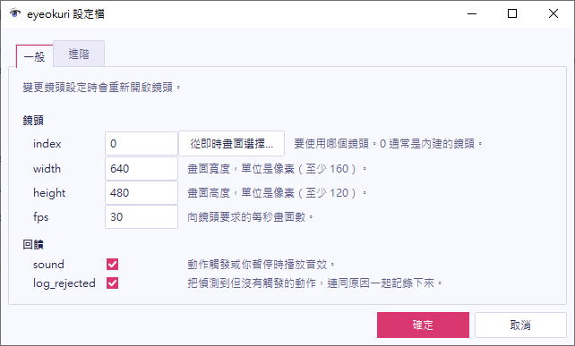

在主視窗開啟 **設定 > 設定檔…**。**一般** 分頁有鏡頭和回饋設定，**進階** 分頁有眼睛和頭部的基準值設定。

## 選擇鏡頭

變更任何鏡頭設定時，都會重新開啟鏡頭。

| 設定 | 說明 |
| --- | --- |
| **index** | 要使用哪個鏡頭。0 通常是內建的鏡頭。 |
| **width**、**height** | 畫面大小，單位是像素。 |
| **fps** | 向鏡頭要求的每秒畫面數。 |

如果你有多個鏡頭，請選擇 **index** 旁邊的 **從即時畫面選擇…**。eyeokuri 會列出它找到的每個鏡頭和即時畫面，選擇你要使用的那一個。

## 控制音效和記錄

- **sound** 會在動作觸發、或是你暫停或繼續時播放音效。
- **log_rejected** 會記錄偵測到但沒有觸發的動作，並附上原因。

## 調整基準值

eyeokuri 會學習你平常睜眼的程度和頭部的位置，並在你的姿勢改變時持續調整。**進階** 分頁可以設定它如何學習：

- **baseline_window_s** 是它使用的歷史秒數。如果光線或距離常常變動，眼睛可以試試 5。如果移開視線一陣子就讓頭部的零點跑掉，頭部可以調高。
- **warmup_s** 是動作可以觸發之前，它學習的秒數。這個數字必須小於上面的歷史秒數。
- **require_both_eyes** 要求雙眼都要閉上，所以眨單眼不算。

## 變更語言

當 eyeokuri 有對應的翻譯時，視窗會跟隨你的 Windows 顯示語言，否則使用英文。如果你想自己選擇語言，請在 `config.toml` 的 `[app]` 區段，把 `language` 設為 `"en"`、`"ja"` 或 `"zh-TW"`。預設值 `"auto"` 會跟隨 Windows。變更會在你下次啟動視窗時生效。

## 儲存或取消

設定視窗的運作方式和[動作視窗](../edit-a-gesture/#儲存或取消)一樣。eyeokuri 會立刻使用你的變更，**確定** 會儲存變更，**取消** 則回到你開啟視窗時的設定。
