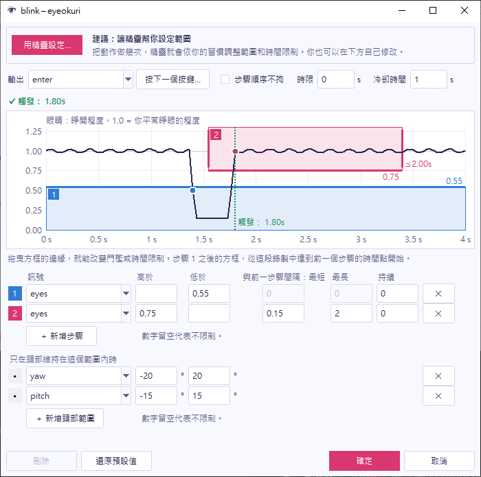

動作那一列的齒輪按鈕（⚙）會開啟它的視窗。你可以在這裡變更動作的設定，並立刻在自己的動作上看到結果。

## 看懂圖表

動作是由一串步驟組成。每個步驟都是一個方框，畫在某個訊號隨時間變化的圖上；訊號進入方框的那一刻，這個步驟就算達成。訊號有：

- **眼睛**（`eyes`）：你的眼睛睜開的程度。1.0 是你平常睜眼的程度。
- **單眼**（`wink`）：右眼睜開的程度減去左眼睜開的程度，兩者都以各自平常的程度為基準。雙眼都睜開或都閉上時，它會維持在 0 附近。只閉左眼會讓它趨近 +1，只閉右眼則趨近 −1。
- **頭部俯仰**（`pitch`）：頭部俯仰的角度。正數是低頭。
- **頭部左右轉**（`yaw`）：頭部左右轉的角度。正數是向你的左邊轉。
- **頭部左右歪**（`roll`）：頭往肩膀歪的角度。正數是往你的左肩歪。

畫面中的眨眼有兩個步驟。方框 1 是「eyes 低於 0.6」，方框 2 是「eyes 高於 0.7，在步驟 1 之後 0.1 秒到 1 秒之間」。深色的線是你最近 4 秒的訊號。

## 測試你的設定

1. 開啟動作視窗，並做一次這個動作。
2. 看圖上方的那一行。它會顯示 `✓ 觸發： 1.83s`，或是動作沒有觸發的原因，例如 `✕ 不會觸發：Step 2 came 0.07s after step 1 (too short, min 0.10s)`。原因是英文。
3. 變更一項設定，再看一次那一行。它會隨著你變更設定而更新。

圖表只在記憶體中保留眼睛和頭部的數字，絕不會保留影像。

## 變更範圍

你可以用兩種方式變更範圍：

- 拖曳方框的上邊界或下邊界，可以改變門檻；拖曳左邊界或右邊界，可以改變前一個步驟之後允許的時間。
- 在圖表下方的步驟表格中輸入數字。

每個步驟都有自己的設定，所以變更一個步驟不會影響其他步驟。

| 欄位 | 說明 |
| --- | --- |
| **訊號** | 這個步驟觀察的訊號。步驟也可以觀察另一個動作，在那個動作觸發時算數。 |
| **高於**、**低於** | 方框的範圍。其中一個留空，方框在那一邊就是開放的。 |
| **與前一步驟間隔：最短**、**最長** | 距離前一個步驟允許的時間。0 代表不限制。 |
| **持續** | 訊號必須在方框內停留多久，這個步驟才算數。 |

圖表上方有：

- **時限** 是從第一個步驟到最後一個步驟允許的時間。0 代表不限制。
- **冷卻時間** 是動作觸發之後，在這段時間內不能再次觸發。
- **步驟順序不拘** 讓步驟可以用任一種順序發生。搖頭動作就使用它，所以你可以從任一邊開始。

## 避免在你轉頭看別處時觸發

移動頭部常常會讓你眨眼，而且轉頭或歪頭也會改變眼睛看起來睜開的程度。**只在頭部維持在這個範圍內時** 這幾列會限制整個動作的頭部角度。頭部超出範圍時，動作無法開始，進行到一半的動作也會被取消。記錄會說明原因，例如 `blink: canceled (head yaw +25° outside its limit)`。

預設情況下，只有當你的頭部在左右方向離平常姿勢 20° 以內、上下方向 10° 以內時，眨眼才會算數。如果刪除這幾列，不論頭部是什麼角度，眨眼都會算數。

## 選擇動作送出什麼

**輸出** 是動作送出的內容。你可以直接輸入、從清單選擇，或是選擇 **按下一個按鍵…**，再按下按鍵或組合鍵。

- 一個按鍵，例如 `enter`、`space`、`up`、`f5` 或 `a`。
- 加上修飾鍵（`ctrl`、`shift`、`alt`、`win`）的按鍵，用 `+` 連接，例如 `ctrl+s`。
- 滑鼠輸入：`mouse_left_click`、`mouse_right_click` 或 `mouse_wheel_down`。
- `app_pause_toggle`，用來暫停或繼續 eyeokuri。
- `(none)`，什麼都不送出。給被其他動作當成步驟的動作使用。

## 按住按鍵

有些遊戲在你按住 `ctrl` 時會跳過文字。**按下一個按鍵…** 旁邊的清單決定動作怎麼送出輸出：

- **按一下（press）**：動作每次觸發時，eyeokuri 會按下再放開輸出。
- **按住不放，直到再次觸發（toggle）**：動作觸發時，eyeokuri 會按下輸出並保持按住。記錄會顯示 `blink: ... -> ctrl held`。再次觸發時，eyeokuri 會放開（`-> ctrl released`）。
- **動作持續時按住（while）**：動作觸發時，eyeokuri 會按下輸出，動作結束時放開。當訊號離開完成這個動作的步驟的方框時，動作就結束；如果那個步驟是另一個動作，則是那個動作結束時。頭部轉到動作的頭部範圍之外，也會結束。

例如，要在閉著左眼時跳過文字，就讓動作只有一個步驟：**單眼**、**高於** 0.25、**持續** 0.3 秒。把輸出設為 `ctrl`，並選擇 **動作持續時按住**。左眼閉上 0.3 秒後會按下 `ctrl`，睜開時放開。內建的眨左眼會在你睜開眼睛時觸發，所以比較適合 **按住不放，直到再次觸發**。內建的頭往右歪（`tilt_right`）就是用這種方式，在頭往右肩歪的期間按住 `ctrl`。

當你暫停、臉離開鏡頭、開啟編輯設定的視窗，或 eyeokuri 停止時，也會放開。

可以按住的是按鍵、組合鍵、`mouse_left_click` 或 `mouse_right_click`。按住的按鍵對所有應用程式都有效，不只是遊戲：如果在按住時切換到其他視窗，你在那裡輸入的內容也會加上 `ctrl`。其他動作的輸出不能使用這個動作按住的按鍵。如果在按住按鍵時用工作管理員結束 eyeokuri，按一下那個按鍵就會放開。

## 儲存或取消

eyeokuri 會在你變更時立刻使用變更，但在你完成之前不會儲存：

- **確定** 會把設定儲存到設定檔，並關閉視窗。
- **取消** 會回到你開啟視窗時的設定，並關閉視窗。用其他方式關閉視窗，效果和 **取消** 一樣；如果你有變更內容，會先詢問你。
- **還原預設值** 會把內建動作的設定放回預設值。動作原本是開啟或關閉，仍會維持不變。
- **刪除** 會移除你新增的動作。如果其他動作把它當成步驟，請先從那邊移除。你不能刪除內建動作，請改為關閉它。

儲存時，設定檔會被重新寫入，而且只保留和預設值不同的項目，所以檔案中的註解不會保留。

## 組合動作

主視窗的 **新增動作…** 可以加入你自己的動作。例如，把某個步驟的 **訊號** 設為 **動作：往下點頭（nod_down）**，就能做出需要先完成另一個動作的新動作，例如眨眼之後 1.5 秒內點頭。

當一個動作同時符合好幾個動作時，每個動作都會觸發。眨眼之後再點頭，也會觸發眨眼，所以也會送出眨眼的按鍵。
