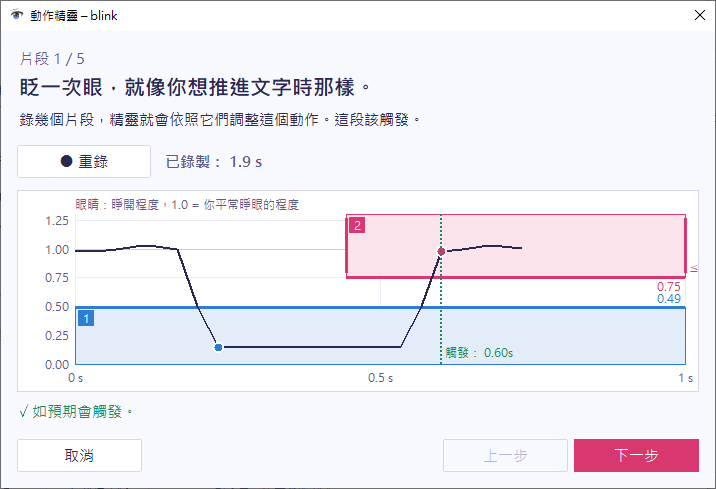

精靈會依你自己的動作來設定動作，所以你不必自己算數字。開啟動作的視窗，選擇 **用精靈設定…**。

## 錄製片段

精靈會請你做 3 次動作本身，要照你希望被算進去的方式做；接著，每種太快或太慢的情況各請你做一次。以眨眼來說，這兩種情況是快速的自然眨眼，和長時間閉眼。

每個片段都有自己的一頁，說明要做什麼：

1. 選擇 **● 錄製**，或按 `Space`。
2. 照頁面上的說明做。
3. 選擇 **■ 停止**，或再按一次 `Space`。

頁面會顯示這個片段在目前調整出的設定下會不會觸發。選擇 **● 重錄** 可以再錄一次，選擇 **下一步** 則繼續。太快或太慢的片段可以用 **略過** 跳過。

對於太快或太慢的片段，你還要選擇它該不該觸發。例如，如果你希望平常的眨眼也能推進文字，就在快速眨眼那一頁選擇 **是**。

精靈開著時，動作會停用，所以不會有任何輸入送到其他視窗。

## 檢查調整結果

精靈會依你所有的片段來調整動作：

- 它會把每個步驟的邊界，移到朝你最弱的片段前進 60% 的位置。動作必須持續兩個畫面才算數，所以單獨一個雜訊畫面不會決定邊界。
- 如果有不該觸發的片段動得比那個位置更大，而且還有空間，邊界就會移到它的上方。當沒有任何設定能把那個片段和其他片段區分開來時，檢查頁面會告訴你。
- 對於動作在你的片段和太快、太慢的片段之間原本就有的時間限制，它也會一併調整。原本關閉的限制會維持關閉。

檢查頁面會列出每個片段在新設定下會不會觸發，以及有哪些變更。選擇一個片段，就能在圖上看到它。選擇 **重錄片段** 可以重錄其中一個。

## 套用結果

選擇 **套用這些設定**。精靈會把結果放進動作視窗，動作會立刻使用它。接著在動作視窗選擇 **確定** 來儲存，或是先[微調](/zh-tw/guide/edit-a-gesture/)。

## 精靈的限制

精靈是從你在動作視窗中的編輯開始的。只有在這些編輯都有效、而且每個步驟都在觀察訊號時，才能使用 **用精靈設定…**。如果動作的步驟是其他動作，就不能使用精靈，請改為設定組成它的那些動作。
