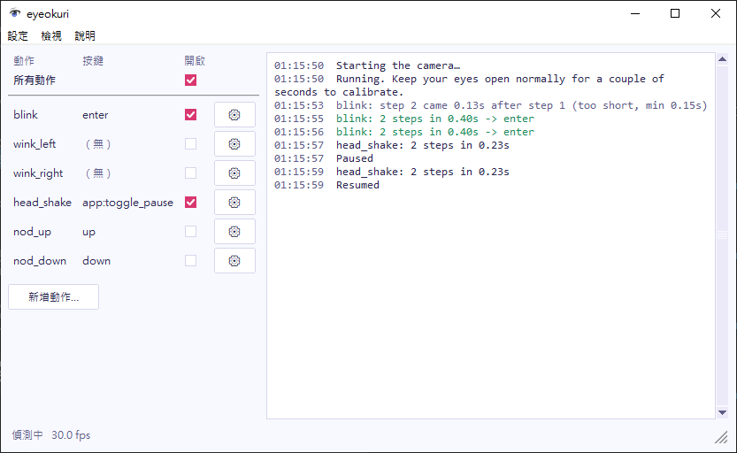

主視窗的左邊列出你的動作，右邊顯示記錄。你可以用 `eyeokuri-gui` 啟動它，或是開啟 Windows 版。

## 開啟或關閉動作

每一列會顯示動作的名稱和它送出的按鍵，並有兩個控制項：

- **開啟** 欄的核取方塊可開啟或關閉這個動作。eyeokuri 會立刻把變更儲存到設定檔。
- 齒輪按鈕（⚙）會開啟這個動作的視窗。請參閱[編輯動作](/zh-tw/guide/edit-a-gesture/)。

**新增動作…** 會先請你輸入名稱，再為新動作開啟動作視窗。

## 暫停 eyeokuri

清單最上方的 **所有動作** 核取方塊可以暫停或繼續 eyeokuri。按 `p` 鍵或搖頭也有一樣的效果。

暫停時，動作仍會觸發，但只會出現在記錄中，例如 `blink: ... -> enter (paused, not sent)`。當你想試試動作、又不想讓遊戲收到輸入時，就可以暫停。eyeokuri 會儲存暫停的狀態，所以如果你離開時是暫停的，下次啟動時也會從暫停開始。

## 查看記錄

記錄會顯示：

- 已觸發的動作，以綠色顯示，例如 `blink -> enter`。
- 偵測到但沒有觸發的動作，以灰色顯示並附上原因，例如 `blink: step 2 came 0.12s after step 1 (too short, min 0.15s)`。
- 暫停和繼續。

記錄中的動作名稱和原因都是英文。原因會告訴你該調整哪個設定。如果你不想記錄沒有觸發的動作，請在[設定視窗](/zh-tw/guide/config-window/)中取消勾選 **log_rejected**。

底部的狀態列會顯示 eyeokuri 目前看到的情況：`校準中…`、`偵測中`、`閉眼中`、`沒有偵測到臉` 或 `已暫停`，以及每秒畫面數。編輯動作時，它會顯示 `編輯中，動作已停用`。

## 開啟其他視窗

| 選單 | 項目 | 開啟 |
| --- | --- | --- |
| 設定 | **設定檔…** | [設定視窗](/zh-tw/guide/config-window/)，可設定鏡頭、音效和記錄。 |
| 檢視 | **鏡頭畫面…** | 鏡頭的即時畫面，並標出你的眼睛輪廓和訊號數值。 |
| 說明 | **關於 eyeokuri…** | 授權條款和第三方聲明。 |

鏡頭畫面會出現在主視窗旁邊。eyeokuri 只在這個視窗開著時才會繪製畫面，所以不需要時請把它關掉，以節省 CPU。

動作、設定或精靈視窗開著時，動作會停用，主視窗的控制項也會變成無法操作。這些視窗同時只能開一個。

## 鏡頭中斷時

如果鏡頭停止傳送畫面，例如暫時斷線，eyeokuri 會每秒重新開啟一次鏡頭，直到畫面恢復。中斷期間不會偵測動作。
